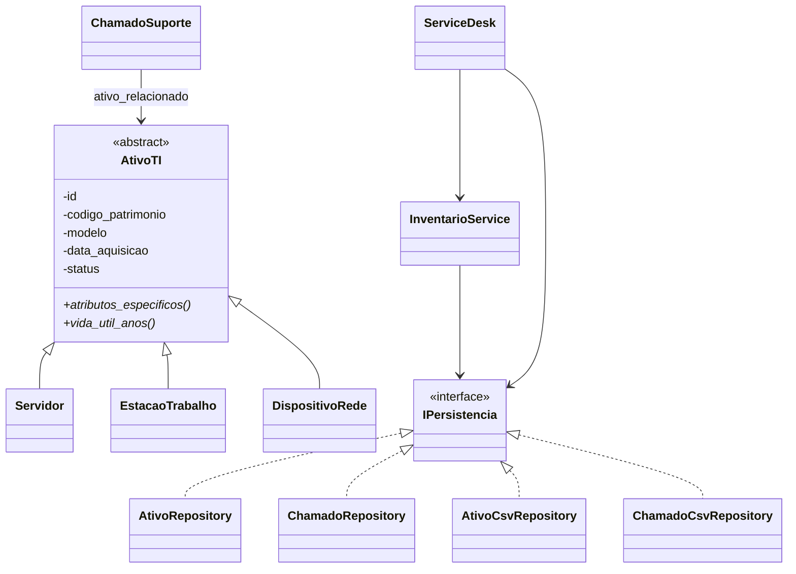

# TechLab Inventory & Service Desk

Projeto da disciplina **Programação Orientada a Objetos e Persistência** (Faculdade SENAC CE).
Sistema de **gestão de ativos de TI** (servidores, estações de trabalho e equipamentos de rede)
e de **chamados de suporte técnico**, com arquitetura em camadas e persistência em CSV e SQLite.

- **Linguagem:** Python 3.10 ou superior
- **Dependências externas:** nenhuma (somente a biblioteca padrão: `sqlite3`, `csv`, `unittest`...)
- **Ferramentas:** Git e GitHub

## Funcionalidades

| Requisito do enunciado | Onde está |
|---|---|
| Classe abstrata `AtivoTI` com encapsulamento | `techlab/dominio/ativo_ti.py` |
| Herança: `Servidor`, `EstacaoTrabalho`, `DispositivoRede` | `techlab/dominio/` |
| Entidade `ChamadoSuporte` | `techlab/dominio/chamado_suporte.py` |
| Interfaces `IConexaoBD`, `INotificavel`, `IPersistencia` | `techlab/interfaces.py` |
| Exceções personalizadas | `techlab/excecoes.py` |
| Coleções, filtros, buscas, ordenação e DTOs | `techlab/servicos/inventario_service.py`, `techlab/dto.py` |
| Persistência em arquivo CSV | `techlab/persistencia/csv_repository.py` |
| Banco relacional (SQLite) + padrão DAO/Repository + CRUD | `techlab/persistencia/ativo_repository.py`, `chamado_repository.py` |
| Proteção contra SQL Injection | consultas parametrizadas (`?`) e lista de permissão no `ORDER BY` |
| Testes automatizados | `tests/` |

## Como executar

```bash
# 1. clonar o repositório
git clone <URL_DO_SEU_REPOSITORIO>
cd techlab-inventory-service-desk

# 2. (opcional) criar ambiente virtual
python -m venv .venv
source .venv/bin/activate        # Windows: .venv\Scripts\activate

# 3. executar o sistema com dados de exemplo
python main.py --demo
```

Opções da linha de comando:

| Opção | Descrição |
|---|---|
| `--backend sqlite` (padrão) ou `--backend csv` | Escolhe onde os dados são gravados |
| `--dados PASTA` | Pasta dos arquivos de dados (padrão: `dados/`) |
| `--demo` | Carrega equipamentos e chamados de exemplo se o inventário estiver vazio |
| `--log ARQUIVO` | Grava as notificações em arquivo em vez de mostrá-las no terminal |

Exemplos:

```bash
python main.py --backend csv --demo      # etapa de persistência em arquivos
python main.py --backend sqlite          # etapa final, com banco relacional
python -m techlab --demo                 # forma alternativa de executar
```

## Executar os testes

```bash
python -m unittest discover -s tests -t . -v
```

## Arquitetura

```
 Apresentação      cli.py  (menu interativo)
        |
 Aplicação         aplicacao.py  (monta as dependências)
        |
 Serviços          InventarioService · ServiceDesk · migracao
        |            (dependem só das interfaces)
 Contratos         IPersistencia · IConexaoBD · INotificavel
        |
 Infraestrutura    CSV · SQLite (DAO) · Notificadores (console / arquivo)
        |
 Domínio           AtivoTI > Servidor | EstacaoTrabalho | DispositivoRede · ChamadoSuporte
```



Mais detalhes em [`docs/ARQUITETURA.md`](docs/ARQUITETURA.md).

## Estrutura de pastas

```
techlab-inventory-service-desk/
├── main.py                      # ponto de entrada
├── techlab/
│   ├── dominio/                 # entidades e regras do domínio
│   ├── servicos/                # regras de negócio e coleções em memória
│   ├── persistencia/            # CSV, SQLite, schema, DAOs
│   ├── notificacao/             # implementações de INotificavel
│   ├── interfaces.py            # contratos
│   ├── excecoes.py              # exceções personalizadas
│   ├── dto.py                   # objetos de transferência de dados
│   ├── aplicacao.py             # composição das dependências
│   ├── dados_demo.py            # dados de exemplo
│   └── cli.py                   # interface de linha de comando
├── tests/                       # testes automatizados (unittest)
├── docs/                        # arquitetura e documentos
└── dados/                       # arquivos .csv e .db gerados (ignorados pelo Git)
```
